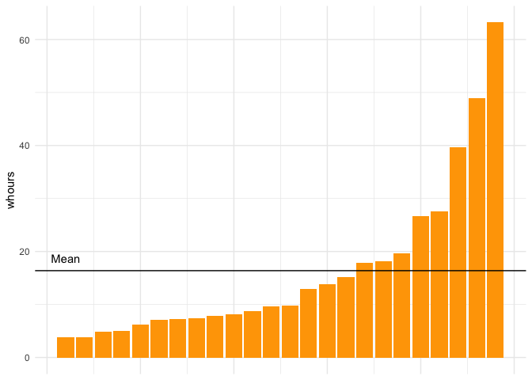
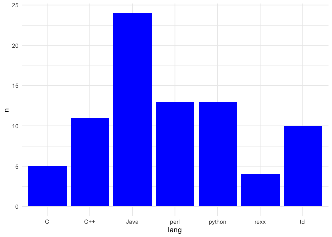
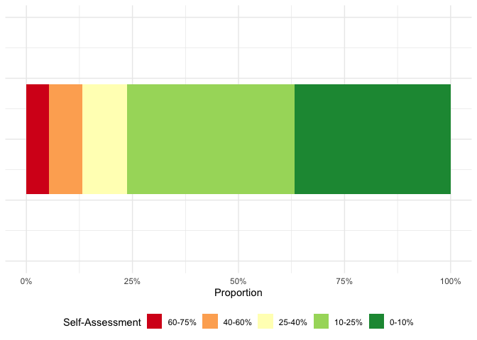
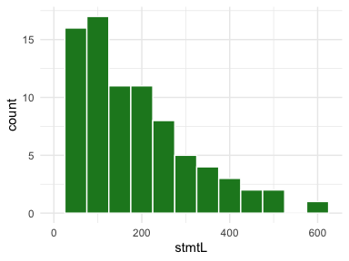
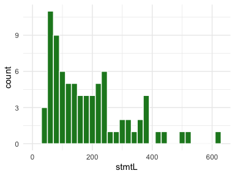
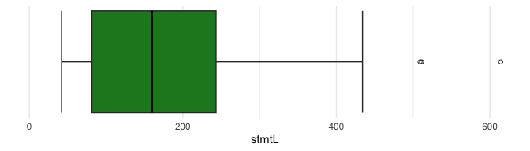
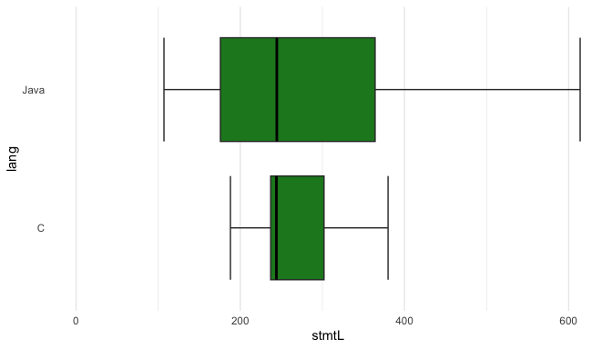
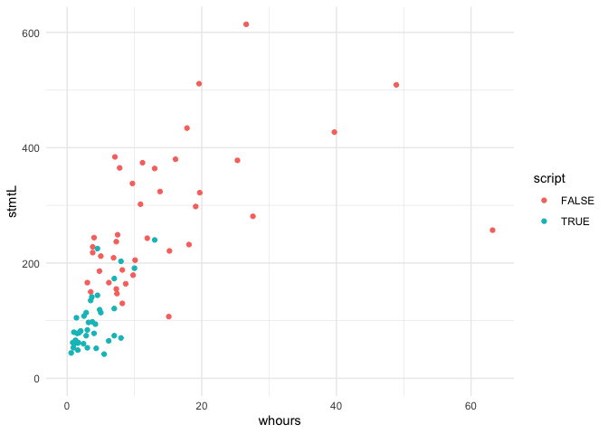
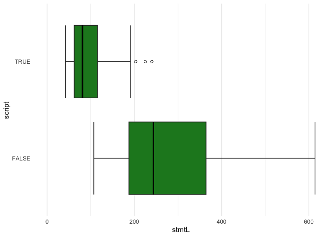
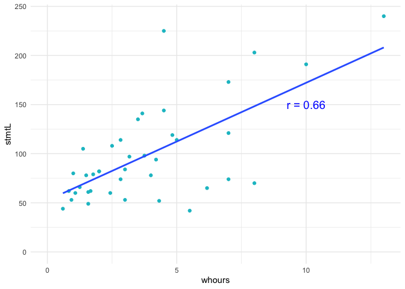

# Quantitative Data Analysis
Franz Zieris
2025-10-10

This overview is created with [Quarto](https://quarto.org) and uses the
[R](https://www.r-project.org/) programming language for statistics and
plotting (see [source file](quantitative-analysis-examples.qmd)). The
analyses and plots shown here are based on [real-world data](data/).

``` r
# Load necessary libraries
library(tidyverse) # for analyses and plots

# Increase console output width
options("width" = 100)
```

## Obtaining and Preparing the data

Read data from the CSV file. It is mostly clean already, so we only need
to standardize two different `NA` values, and introduce a new variable
`script` to summarize types of programming languages.

``` r
df <- read_csv("data/jccpprtTR.csv", col_types = "ccddiidddf") |>
    mutate(
        # Standardize and order caps column
        caps = caps |> fct_na_level_to_value(extra_levels = c("??", "NA")),
        caps = caps |> fct_relevel(sort(levels(caps))),
        # New boolean variable for convenience
        script = lang %in% c("perl", "python", "rexx", "tcl")
    )

df |> print(n = 5)
```

    # A tibble: 80 × 11
      person lang  z1000t   z0t z1000mem stmtL z1000rel m1000rel whours caps  script
      <chr>  <chr>  <dbl> <dbl>    <int> <int>    <dbl>    <dbl>  <dbl> <fct> <lgl> 
    1 s018   C      0.017 0.017    22432   380     98.1     96.8   16.1 <NA>  FALSE 
    2 s030   C      0.05  0.033    16968   244     76.5     92.1    4   <NA>  FALSE 
    3 s036   C     20.9   0        11440   188      0       89.5    8.2 <NA>  FALSE 
    4 s066   C      0.75  0.467     2952   237     98.5    100      7.3 <NA>  FALSE 
    5 s078   C      0.05  0.05     22496   302     99.2     98.4   10.9 <NA>  FALSE 
    # ℹ 75 more rows

## Exploring the Data

We use descriptive statistics and simple plots to take a first look at
our data.

### Average Work Hours per Programming Language

``` r
df |>
    summarize(avg_whours = mean(whours), .by = lang)
```

    # A tibble: 7 × 2
      lang   avg_whours
      <chr>       <dbl>
    1 C            9.3 
    2 C++         12.1 
    3 Java        16.4 
    4 perl         3.38
    5 python       3.11
    6 rexx         5.48
    7 tcl          4.66

``` r
df |>
    filter(lang == "Java") |>
    arrange(whours) |>
    mutate(no = row_number()) |>

    # Bar chart
    ggplot(aes(x = no, y = whours)) +
    geom_col(fill = "orange") +

    # Add horizontal line at mean value
    geom_hline(aes(yintercept = mean(whours))) +
    geom_text(aes(x = 1, y = mean(whours)), label = "Mean", check_overlap = TRUE, vjust = -1) +

    # Optics
    theme_minimal() +
    theme(
        axis.title.x = element_blank(),
        axis.text.x = element_blank()
    )
```

<div id="fig-java-whours">



Figure 1: Work time spent on Java programs

</div>

### Visualizing One Variable (Nominal or Ordinal)

``` r
df |>
    count(lang) |>

    # Bar chart
    ggplot(aes(x = lang, y = n)) +
    geom_bar(stat = "identity", fill = "blue") +

    # Optics
    theme_minimal()
```

<div id="fig-nominal-bar-chart">



Figure 2: Bar charts work even for nominal variables, because we only
need to count.

</div>

``` r
df |>
    filter(!is.na(caps)) |>
    count(caps) |>

    # Stacked bar chart
    ggplot(aes(x = 1, y = n, fill = caps)) +
    geom_bar(stat = "identity", position = "fill") +

    # Optics
    coord_flip(xlim = c(0, 2)) +
    ylab("Proportion") +
    scale_y_continuous(labels = scales::label_percent()) +
    scale_fill_brewer(name = "Self-Assessment", palette = "RdYlGn", direction = -1) +
    guides(fill = guide_legend(reverse=T)) +
    theme_minimal() +
    theme(
        axis.title.y = element_blank(),
        axis.text.y = element_blank(),
        legend.position = "bottom",
    )
```

<div id="fig-ordinal-stacked-bar-chart">



Figure 3: Ordinal variables should be shown in order, possibly even
stacked.

</div>

### Visualizing One Variable (Interval or Ratio) with Histograms

``` r
histogram <- function(df, binwidth) {
    df |>
        ggplot(aes(x = stmtL)) +
        geom_histogram(fill = "#1e8625ff", color = "white", binwidth = binwidth) +

        # Optics
        coord_cartesian(xlim = c(0, NA)) +
        theme_minimal()
}

df |> histogram(50)

df |> histogram(20)
```

<div id="fig-histograms-1">



Figure 4: Wide bins (here: 50) lead to smoother shapes

</div>

<div id="fig-histograms-2">



Figure 5: Narrow bins (here: 20) lead to jagged shapes

</div>

### Visualizing One Variable (Interval or Ratio) with Boxplots

``` r
geom_boxplot_custom <- function(...) {
    geom_boxplot(staplewidth = 1, outlier.shape = 1, median.color = "black", ...)
}

df |>
    ggplot(aes(x = stmtL)) +
    geom_boxplot_custom(fill = "#1e8625") +

    # Optics
    coord_cartesian(ylim = c(NA, NA), xlim = c(0, NA)) +
    theme_minimal() +
    theme(
        axis.title.y = element_blank(),
        axis.text.y = element_blank(),
        panel.grid.major.y = element_blank(),
        panel.grid.minor.y = element_blank()
    )
```

<div id="fig-boxplot">



Figure 6: A box plot showing the middle 50% (box), median (thick line),
min and max without outliers (whiskers), and outliers (separate dots).

</div>

### Visualizing Differences in Data with Boxplots

``` r
df |>
    filter(lang %in% c("Java", "C")) |>
    ggplot(aes(x = stmtL, y = lang)) +
    geom_boxplot_custom(fill = "#1e8625") +

    # Optics
    coord_cartesian(ylim = c(NA, NA), xlim = c(0, NA)) +
    theme_minimal() +
    theme(
        panel.grid.major.y = element_blank(),
        panel.grid.minor.y = element_blank()
    )
```

<div id="fig-boxplot-compare">



Figure 7: Box plots allow to quickly compare distributions.

</div>

The two languages appear to have the same median, but different
dispersion measures.

``` r
df |>
    filter(lang %in% c("Java", "C")) |>
    summarize(
        smedian = median(stmtL),
        siqr    = IQR(stmtL),
        ssd     = sd(stmtL),
        .by = lang
    )
```

    # A tibble: 2 × 4
      lang  smedian  siqr   ssd
      <chr>   <dbl> <dbl> <dbl>
    1 C        244    65   73.5
    2 Java     244.  188. 130. 

### Visualizing Two Variables: Ratio vs. Ratio with Scatterplots

``` r
df |>
    ggplot(aes(x = whours, y = stmtL)) +
    geom_point(aes(color = script)) +

    # Optics
    coord_cartesian(ylim = c(0, NA), xlim = c(0, NA)) +
    theme_minimal()
```

<div id="fig-scatterplot">



Figure 8: Scatterplots show the relation of two ratio variables (and
allow for more variables as well, dot size, shape, color, …)

</div>

## Infer from Data

### Hypothesis Testing

There appears to be a difference in program size between script and
non-script languages (seen in
<a href="#fig-scatterplot" class="quarto-xref">Figure 8</a>, confirmed
in <a href="#fig-boxplot-script" class="quarto-xref">Figure 9</a>):

``` r
df |>
    ggplot(aes(x = stmtL, y = script)) +
    geom_boxplot_custom(fill = "#1e8625") +

    # Optics
    coord_cartesian(ylim = c(NA, NA), xlim = c(0, NA)) +
    theme_minimal() +
    theme(
        panel.grid.major.y = element_blank(),
        panel.grid.minor.y = element_blank()
    )
```

<div id="fig-boxplot-script">



Figure 9: Visually, there is a large difference between the size of
script and non-script programs.

</div>

Testing whether the difference shown in
<a href="#fig-boxplot-script" class="quarto-xref">Figure 9</a> could be
by chance (i.e., how likely is it to see such a difference when there is
actually none in the population that we sampled from).

``` r
wilcox.test(whours ~ script, data = df)
```


        Wilcoxon rank sum test with continuity correction

    data:  whours by script
    W = 1440, p-value = 7.54e-10
    alternative hypothesis: true location shift is not equal to 0

The probability (“p-value”) is *way* smaller than 5% – we accept this as
a “statistically significant difference”.

### Effect Size

``` r
library(effectsize)

effect_size <- cohens_d(whours ~ script, data = df)
effect_size
```

    Cohen's d |       95% CI
    ------------------------
    1.16      | [0.68, 1.63]

    - Estimated using pooled SD.

The effect size 1.16 indicates a large effect (\> 0.8). It means that
the two means of the script and non-script languages are 1.16 standard
deviations apart.

### Correlation Analysis

``` r
r <- with(subset(df, script), cor(whours, stmtL, method = "pearson"))

# Scatter plot (of script languages)
subset(df, script) |>
    ggplot(aes(x = whours, y = stmtL)) +
    geom_point(color = "#11c0ccff") +

    # Add regression line (method = "lm" uses the same calculation as Pearson's r under the hood)
    geom_smooth(method = "lm", formula = y ~ x, se = FALSE) +
    # Add r-value
    annotate("text", x = 10, y = 150, 
           label = paste("r =", round(r, 2)), 
           size = 5, color = "blue") +

    # Optics
    coord_cartesian(ylim = c(0, NA), xlim = c(0, NA)) +
    theme_minimal()
```

<div id="fig-regression-analysis">



Figure 10: There is a moderately strong correlation between the work
time and the size of script programs.

</div>
